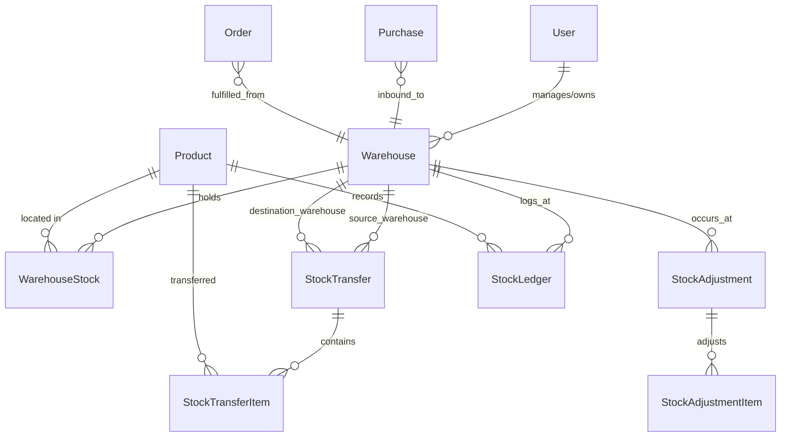
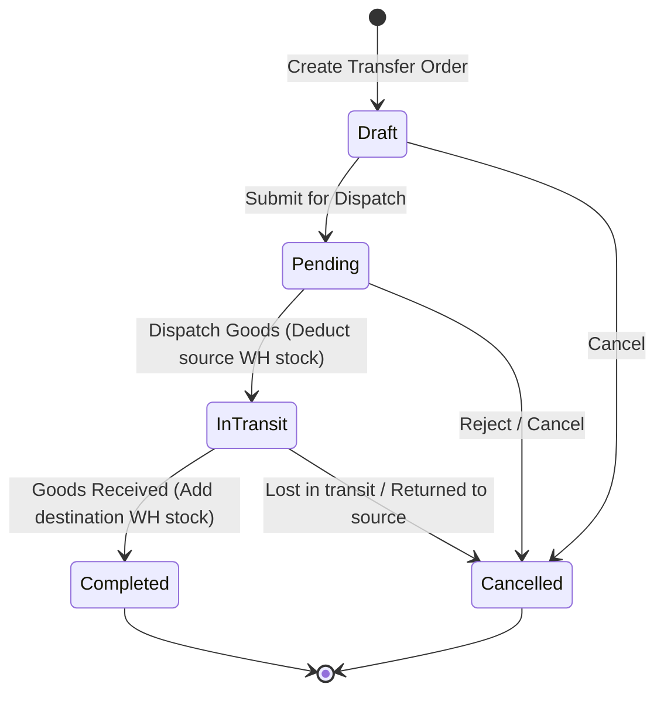
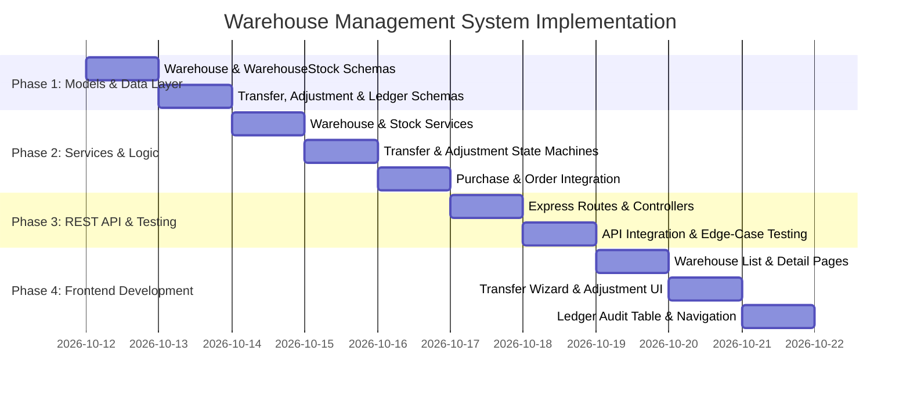

# Warehouse Management System (WMS) — Architecture & Implementation Plan

## 1. Executive Summary & Gap Analysis

Currently, **InventoryPro** functions solely as a single-location inventory tracker:

- Stock is stored as a flat scalar (`stock: Number`) directly on the `Product` model.
- Purchases increment global product stock; Orders deduct global product stock.
- There is no capability to know **where** inventory physically resides, manage multiple distribution centers, transfer goods between facilities, or perform warehouse-level audits and cycle counts.

### Current IMS vs. Target WMS Capabilities

| Capability                 | Current InventoryPro (IMS)         | Target Warehouse Management System (WMS)                            |
| :------------------------- | :--------------------------------- | :------------------------------------------------------------------ |
| **Locations**              | Single implicit global store       | Multi-warehouse hierarchy (Central, Hub, Retail, Transit)           |
| **Stock Resolution**       | `Product.stock` (Single scalar)    | `WarehouseStock` per `(Product, Warehouse)` with Bin/Rack locations |
| **Purchasing**             | Adds stock to global count         | Goods Receipt Note (GRN) into specific destination warehouse        |
| **Order Fulfillment**      | Deducts stock from global count    | Pick/Pack/Ship from specific source warehouse or multi-node routing |
| **Stock Movements**        | Implicit within Orders / Purchases | Explicit Inter-Warehouse Transfers with in-transit state machine    |
| **Audit & Reconciliation** | Overwrites stock manually          | Stock Adjustments (Cycle counts, shrinkage, damage, write-offs)     |
| **Traceability**           | None                               | Immutable `StockLedger` tracking every unit delta and reason        |

---

## 2. Core Architecture & Entity Relationship



---

## 3. Database Schema Design (Mongoose)

### 3.1. `Warehouse` (`warehouse.model.js`)

Represents physical locations (distribution centers, regional hubs, store backrooms).

```javascript
{
  warehouse_name: { type: String, required: true, trim: true },
  warehouse_code: { type: String, required: true, uppercase: true, trim: true }, // e.g. WH-BLR-01
  type: {
    type: String,
    enum: ["central", "regional_hub", "fulfillment_center", "retail_store"],
    default: "regional_hub"
  },
  address: {
    street: String,
    city: { type: String, required: true },
    state: String,
    country: { type: String, default: "India" },
    pincode: { type: String, required: true }
  },
  contact_person: {
    name: String,
    email: String,
    phone: String
  },
  total_capacity_sqft: { type: Number, default: 0 },
  is_active: { type: Boolean, default: true },
  is_default: { type: Boolean, default: false }, // Fallback warehouse for existing data
  created_by: { type: mongoose.Schema.Types.ObjectId, ref: "User", required: true }
}
// Unique compound index: warehouse_code per tenant
warehouseSchema.index({ warehouse_code: 1, created_by: 1 }, { unique: true });
```

### 3.2. `WarehouseStock` (`warehouse-stock.model.js`)

Per-warehouse inventory level for each product, supporting bin locations and reservation for open orders.

```javascript
{
  warehouse_id: { type: mongoose.Schema.Types.ObjectId, ref: "Warehouse", required: true },
  product_id: { type: mongoose.Schema.Types.ObjectId, ref: "Product", required: true },
  quantity: { type: Number, required: true, default: 0, min: 0 },
  reserved_quantity: { type: Number, default: 0, min: 0 }, // Allocated to pending orders
  bin_location: { type: String, default: "A-01-01" }, // Aisle-Rack-Shelf
  min_reorder_level: { type: Number, default: 10 },
  max_capacity: { type: Number, default: 1000 },
  created_by: { type: mongoose.Schema.Types.ObjectId, ref: "User", required: true }
}
// Unique compound index: One stock entry per product per warehouse
warehouseStockSchema.index({ warehouse_id: 1, product_id: 1 }, { unique: true });
```

### 3.3. `StockTransfer` & `StockTransferItem` (`stock-transfer.model.js`)

Inter-warehouse shipment workflow with in-transit tracking.

```javascript
// StockTransfer
{
  transfer_no: { type: String, required: true, unique: true }, // e.g. TR-2026-0001
  source_warehouse_id: { type: mongoose.Schema.Types.ObjectId, ref: "Warehouse", required: true },
  destination_warehouse_id: { type: mongoose.Schema.Types.ObjectId, ref: "Warehouse", required: true },
  status: {
    type: String,
    enum: ["draft", "pending", "in_transit", "completed", "cancelled"],
    default: "draft"
  },
  transfer_date: { type: Date, default: Date.now },
  shipped_date: Date,
  received_date: Date,
  carrier_details: {
    carrier_name: String,
    tracking_number: String,
    vehicle_no: String
  },
  notes: String,
  created_by: { type: mongoose.Schema.Types.ObjectId, ref: "User", required: true }
}

// StockTransferItem
{
  transfer_id: { type: mongoose.Schema.Types.ObjectId, ref: "StockTransfer", required: true },
  product_id: { type: mongoose.Schema.Types.ObjectId, ref: "Product", required: true },
  requested_quantity: { type: Number, required: true, min: 1 },
  shipped_quantity: { type: Number, default: 0 },
  received_quantity: { type: Number, default: 0 }
}
```

### 3.4. `StockAdjustment` (`stock-adjustment.model.js`)

Cycle counting, loss, damage, and reconciliation.

```javascript
{
  adjustment_no: { type: String, required: true, unique: true }, // e.g. ADJ-2026-0001
  warehouse_id: { type: mongoose.Schema.Types.ObjectId, ref: "Warehouse", required: true },
  reason: {
    type: String,
    enum: ["cycle_count", "damage", "expired", "theft_shrinkage", "audit_variance", "found_stock"],
    required: true
  },
  status: { type: String, enum: ["pending", "approved", "rejected"], default: "approved" },
  items: [
    {
      product_id: { type: mongoose.Schema.Types.ObjectId, ref: "Product", required: true },
      system_quantity: { type: Number, required: true },
      physical_quantity: { type: Number, required: true },
      variance: { type: Number, required: true }, // physical - system
      unit_cost: { type: Number, default: 0 }
    }
  ],
  notes: String,
  created_by: { type: mongoose.Schema.Types.ObjectId, ref: "User", required: true }
}
```

### 3.5. `StockLedger` (`stock-ledger.model.js`)

Immutable double-entry log of all inventory mutations.

```javascript
{
  warehouse_id: { type: mongoose.Schema.Types.ObjectId, ref: "Warehouse", required: true },
  product_id: { type: mongoose.Schema.Types.ObjectId, ref: "Product", required: true },
  transaction_type: {
    type: String,
    enum: ["purchase_receipt", "order_dispatch", "transfer_out", "transfer_in", "adjustment_add", "adjustment_deduct", "purchase_return"],
    required: true
  },
  reference_id: { type: mongoose.Schema.Types.ObjectId, required: true }, // Order, Purchase, Transfer, Adjustment ID
  reference_no: { type: String, required: true },
  quantity_before: { type: Number, required: true },
  quantity_change: { type: Number, required: true }, // +ve or -ve
  quantity_after: { type: Number, required: true },
  created_by: { type: mongoose.Schema.Types.ObjectId, ref: "User", required: true },
  timestamp: { type: Date, default: Date.now }
}
```

---

## 4. Key Workflows & State Machines

### 4.1. Inter-Warehouse Transfer Lifecycle



1. **Dispatch (`Pending -> InTransit`)**:
   - Atomic deduction of `shipped_quantity` from `WarehouseStock` at source warehouse.
   - Creates `transfer_out` entry in `StockLedger`.
2. **Receipt (`InTransit -> Completed`)**:
   - Atomic addition of `received_quantity` into `WarehouseStock` at destination warehouse.
   - Creates `transfer_in` entry in `StockLedger`.
   - Global `Product.stock` remains balanced.

### 4.2. Warehouse-Aware Purchasing & Sales Integration

- **Purchases (Inbound / GRN)**:
  - Add optional `warehouse_id` field to `Purchase`.
  - When status transitions to `completed`, stock is incremented in both `WarehouseStock(destination_wh)` and `Product.stock`.
- **Sales Orders (Outbound)**:
  - Add `warehouse_id` field to `Order`.
  - Deduction validates availability at `WarehouseStock(source_wh)`.

---

## 5. Backward Compatibility Strategy

To ensure zero downtime and prevent breaking existing purchase/sales orders:

1. **Default Warehouse Auto-Provisioning**:
   - A default warehouse (e.g. `Main Warehouse - Central`) is created automatically for each user upon migration or first login.
2. **Two-Way Stock Synchronization**:
   - Whenever `WarehouseStock` is modified, `Product.stock` is updated to equal $\sum_{\text{warehouses}} \text{WarehouseStock.quantity}$.
   - Existing endpoints querying `Product.stock` continue to work without modification.
3. **Optional Warehouse Inputs**:
   - If an order or purchase is submitted without a `warehouse_id`, the system defaults to the user's primary/default warehouse.

---

## 6. API Route Specification

### 6.1. Warehouses (`/api/v1/warehouses`)

- `GET /` — List all warehouses for current tenant (with stock summary & capacity).
- `POST /` — Create a new warehouse.
- `GET /:id` — Get warehouse details, manager info, and product inventory breakdown.
- `PUT /:id` — Update warehouse info.
- `DELETE /:id` — Soft-delete / deactivate warehouse (blocked if active stock exists).
- `GET /:id/stock` — Paginated list of products and bin locations in this warehouse.

### 6.2. Stock Transfers (`/api/v1/transfers`)

- `GET /` — List transfers (filterable by source, destination, status).
- `POST /` — Create transfer request (draft or pending).
- `GET /:id` — Get transfer order with itemized quantities and dispatch slip.
- `PATCH /:id/dispatch` — Mark dispatched $\to$ moves to `in_transit`.
- `PATCH /:id/receive` — Mark received at destination $\to$ moves to `completed`.
- `PATCH /:id/cancel` — Cancel transfer and return allocated stock.

### 6.3. Stock Adjustments (`/api/v1/adjustments`)

- `GET /` — List adjustments and audit records.
- `POST /` — Create stock adjustment (cycle count, damage, shrinkage).
- `GET /:id` — View adjustment detail and variance breakdown.

### 6.4. Stock Ledger & Auditing (`/api/v1/stock-ledger`)

- `GET /` — Search audit logs by warehouse, product, date range, or transaction type.

---

## 7. Frontend User Interface Plan

### 7.1. Navigation & Route Tree

Add **"Warehouses"** and sub-routes under `DashboardLayout`:

```
/warehouses               -> Warehouse directory & capacity cards
/warehouses/:id           -> Warehouse detail: Stock by bin, statistics, low-stock
/warehouses/transfers     -> Inter-warehouse transfers table & creation wizard
/warehouses/adjustments   -> Cycle count & stock adjustment reconciliation
/warehouses/ledger        -> Real-time stock movement ledger & audit log
```

### 7.2. UI Components

1. **Warehouse Directory**:
   - Metric cards: Total Warehouses, Total Storage Capacity, In-Transit Transfers, Low Stock Nodes.
   - Interactive table: Name, Code, Location, Utilization bar, Action buttons (Manage, Transfer).
2. **Transfer Management Wizard**:
   - Source Warehouse selector $\to$ Destination Warehouse selector.
   - Dynamic product selector showing available stock at source warehouse in real time.
   - Status badge pipeline: `Draft` $\to$ `Pending` $\to$ `In Transit` $\to$ `Completed`.
3. **Cycle Count / Adjustment Modal**:
   - Select Warehouse and Product $\to$ Displays current system count $\to$ Input physical count $\to$ Displays calculated variance and dollar impact.
4. **Order & Purchase Form Enhancements**:
   - Dropdown in Order modal: _"Fulfill from Warehouse"_.
   - Dropdown in Purchase modal: _"Receive into Warehouse"_.

---

## 8. Phased Implementation Roadmap



---

## 9. Next Steps & User Confirmation

To proceed with implementation, we can execute either:

1. **Phase 1 & 2 (Backend Foundations)**: Build the WMS schemas, services, stock ledger, and API endpoints first.
2. **Full End-to-End Delivery**: Build both the backend API and the frontend UI views in sequential milestones.

Please review this plan and let me know if you would like any modifications or would like to proceed with **Phase 1**!
